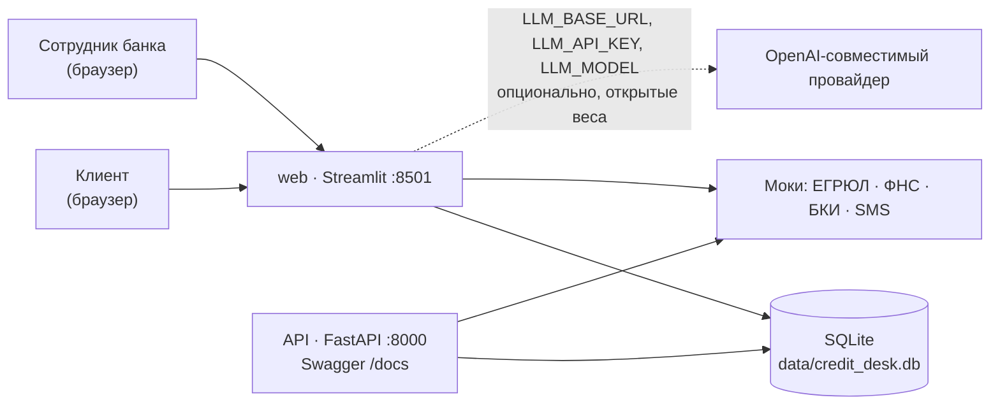

# Кредитный кабинет предпринимателя — демо-решение

Демонстрационный MVP сквозного кредитного конвейера для действующих
клиентов-предпринимателей (ИП и юрлица): от потребности в финансировании до
смоделированной выдачи кредита. Реализованы обе стороны процесса — клиентский
кабинет и обработка заявки банком. Все данные синтетические, внешние системы
(ЕГРЮЛ, ФНС, БКИ, SMS, ЭП, процессинг) смоделированы внутри продукта.

Интерфейс стилизован под визуальный язык Альфа-Банка (альфа-красный `#EF3124`,
плотная гротескная типографика). Это **не** официальный продукт банка: логотип
и товарные знаки не используются, вместо знака — нейтральная литера «А».

## Назначение решения

Показать связанный работающий кредитный процесс:

* **клиент** выбирает продукт, видит расчёт (платёж, переплата, долговая
  нагрузка) до отправки, подаёт заявку, следит за статусом, принимает
  предложение, подписывает демо-кодом и получает смоделированную выдачу;
* **банк** ведёт очередь заявок, запускает проверки (моки внешних источников),
  видит прозрачные правила и сигналы, запрашивает уточнения и фиксирует
  решение с обязательным основанием: одобрение / отказ / встречное предложение;
* **всё сохраняется**: заявки, статусы, документы, решения, выдачи и аудит
  лежат в SQLite и не теряются между этапами и перезапусками.

Ключевые решения по логике: решение по кредиту принимает сотрудник (система
только подсвечивает сигналы по 8 правилам R-01…R-08); ИИ-агенты готовят
материалы, но не решают; LLM опциональна — базовый сценарий полностью
детерминированный.

## Архитектура

Один кодовый базис, два протокола доступа к одному слою данных:
веб-интерфейс (Streamlit) и REST API (FastAPI). Подробнее —
[docs/architecture.md](docs/architecture.md) (со схемой), диаграмма состояний
заявки — [docs/state-diagram.md](docs/state-diagram.md), модель данных —
[docs/data-model.md](docs/data-model.md).



Жизненный цикл заявки: `DRAFT → SUBMITTED → VALIDATION → ENRICHMENT →
SCORING → MANUAL_REVIEW → APPROVED/CONDITIONAL_APPROVAL → ACCEPTED → SIGNING →
SIGNED → DISBURSED`, с ветками `NEEDS_INFO` (запрос уточнений) и `REJECTED`
(отказ, в т.ч. отказ клиента от предложения). Переходы валидируются картой
`rules.ALLOWED_TRANSITIONS` и в UI, и в API.

## Требования к окружению

* Docker 20.10+ и Docker Compose v2 — рекомендуемый способ запуска;
  **либо** Python 3.15 с pip (для Windows используйте обновлённый `requirements.lock.txt`; `pandas` закреплён на версии 3.1.0 с готовыми колёсами для Python 3.15).
* ОЗУ: достаточно обычного офисного ноутбука (сервисы лёгкие, LLM в поставку
  не входит; ориентир кейса ~12 ГБ относится к серверному запуску своей
  LLM, что опционально).
* Интернет при первом запуске — для скачивания базового образа и pip-пакетов.
* Порт 8501 (веб) и 8000 (API) должны быть свободны.

## Инструкция запуска

### Вариант 1 — Docker (рекомендуется)

```bash
cp .env.example .env      # при желании настройте LLM_* и PIN-коды
docker compose up --build
```

* Веб-интерфейс: http://localhost:8501
* REST API + Swagger: http://localhost:8000/docs

Останов: `docker compose down`. Данные сохраняются в `./data` (том).

### Вариант 2 — локально без Docker

**Windows CMD (Python 3.15):** из папки `credit-desk` выполните:

```bat
py -3.15 -m venv .venv
.venv\\Scripts\\activate
python -m pip install --upgrade pip
python -m pip install -r requirements.lock.txt
```

Затем откройте два окна CMD в папке проекта. В первом:

```bat
.venv\\Scripts\\activate
python -m uvicorn api:app --host 127.0.0.1 --port 8000
```

Во втором:

```bat
.venv\\Scripts\\activate
python -m streamlit run app.py --server.port 8501 --server.address 127.0.0.1
```

**Linux/macOS:** используйте `python -m venv .venv`, активируйте окружение командой `source .venv/bin/activate`, установите `pip install -r requirements.lock.txt`, затем запустите API и Streamlit в отдельных терминалах.

Веб-интерфейс: http://localhost:8501. API: http://localhost:8000/docs.

База `data/credit_desk.db` создаётся автоматически и наполняется пятью
демо-заявками при первом запуске.

## Конфигурации и переменные окружения

| Переменная | По умолчанию | Назначение |
| --- | --- | --- |
| `LLM_BASE_URL` | — | Базовый URL OpenAI-совместимого провайдера (vLLM, Ollama, LM Studio, OpenRouter). Пусто = без LLM |
| `LLM_API_KEY` | — | Токен провайдера. Пусто = без LLM (детерминированный режим) |
| `LLM_MODEL` | `Qwen/Qwen2.5-7B-Instruct` | Модель **открытых весов** ≤120B (требование кейса). Провайдер заменяется без правок кода |
| `DEMO_CLIENT_PIN` | `1234` | Тестовый PIN клиента |
| `DEMO_BANK_PIN` | `0007` | Тестовый PIN сотрудника банка |

LLM — необязательный компонент: без ключей решение работает полностью
автономно. Модель с открытых весов можно скачать при первом запуске (например,
`ollama pull qwen2.5:7b`) и указать `LLM_BASE_URL=http://localhost:11434/v1`.
Веса в репозиторий не включены; источник модели и процесс загрузки описаны в
[THIRD_PARTY_NOTICES.md](THIRD_PARTY_NOTICES.md).

## Описание компонентов

| Компонент | Назначение |
| --- | --- |
| `app.py` | Веб-интерфейс: клиентский кабинет, рабочий кабинет банка, аналитика портфеля, описание проекта. Демо-вход по PIN |
| `api.py` | REST API (FastAPI): тот же жизненный цикл, Swagger на `/docs`, спецификация `openapi.yaml` |
| `database.py` | SQLite: заявки, аудит, документы, решения, выдачи, коды подписания; валидация переходов; синтетические демо-данные |
| `rules.py` | 8 прозрачных бизнес-правил (R-01…R-08), справочник статусов, карта переходов `ALLOWED_TRANSITIONS` |
| `finance.py` | Аннуитет, график платежей, долговая нагрузка, лимиты; демо-ставки от ключевой ставки ЦБ 14% |
| `ai_module.py` | Резюме заявки, 5 ИИ-агентов, чек-лист документов, черновик письма клиенту; LLM опциональна |
| `theme.py` | Палитра, типографика, переиспользуемые UI-компоненты |
| `docs/` | Архитектура, диаграмма состояний, модель данных, API, тестовые сценарии |
| `postman_collection.json` | Коллекция запросов Postman для end-to-end проверки API |
| `scripts/demo_e2e.sh` | Автоматический прогон основного сценария через API (curl) |

## Пошаговый сценарий проверки

### Через веб-интерфейс (основной)

1. Откройте http://localhost:8501, выберите **«Клиентский кабинет»**, войдите
   с PIN `1234`.
2. Вкладка «Новая заявка»: заполните поля (например, ООО «Ромашка», ИНН
   7700123456, «Оборотное финансирование», 2 400 000 ₽, 18 мес., выручка
   18 000 000 ₽) — справа обновляется расчёт; отправьте заявку.
3. Переключитесь в **«Рабочий кабинет банка»** (PIN `0007`, роль «Аналитик»),
   найдите заявку, нажмите «Запустить демо-проверки» — заявка дойдёт до
   «На ручном разборе»; на вкладке «Источники» — mock-ответы ЕГРЮЛ/ФНС/БКИ.
4. Смените роль на «Старший аналитик», во вкладке «Действия» зафиксируйте
   «Одобрена» с основанием (или проверьте отказ/запрос уточнений на демо-заявках).
5. Вернитесь в **«Клиентский кабинет»**: примите предложение → получите
   демо-код подписания (показан в интерфейсе вместо SMS) → подпишите →
   получите кредит. Статус «Выдана», в аудите — смоделированная выдача.
6. Демо-заявка **ООО «ТехноПарк-Юг»** показывает встречное предложение,
   **ООО «Тёплый хлеб»** — запрос уточнений, **ООО «Марена-Логистик»** —
   завершённую сделку с выдачей.

### Через API / Postman

1. Откройте http://localhost:8000/docs или импортируйте `postman_collection.json`.
2. Пройдите сценарий теми же шагами: `POST /api/applications` →
   `POST /api/applications/{ref}/checks` → `POST .../decision` →
   `POST .../accept` → `POST .../signing-code` → `POST .../sign` →
   `POST .../disburse`. PIN передаётся в заголовке `X-Demo-Pin`.
3. Автоматический прогон: поднимите сервисы (`docker compose up` или локально)
   и выполните `API_BASE=http://localhost:8000 bash scripts/demo_e2e.sh` —
   скрипт проверит весь сценарий и негативные ветки.

Полные сценарии с ожидаемыми результатами — [docs/test-scenarios.md](docs/test-scenarios.md).

## Тестовые учётные записи и данные

| Роль | PIN | Заголовок API | Доступно |
| --- | --- | --- | --- |
| Клиент (ИП Соколов А. В.) | `1234` | `X-Demo-Pin: 1234` | Заявки, принятие предложения, подписание, получение кредита |
| Аналитик банка | `0007` | `X-Demo-Pin: 0007` | Очередь, проверки, запрос уточнений |
| Старший аналитик / админ | `0007` | `X-Demo-Pin: 0007` | Плюс финальное решение и смоделированная выдача |

Демо-заявки (синтетические): «Северный склад» (ручной разбор, блокирующие
сигналы), «Тёплый хлеб» (запрос уточнений), ИП Соколов (новая заявка —
проводится по полному конвейеру), «ТехноПарк-Юг» (встречное предложение),
«Марена-Логистик» (выдана). Сброс — кнопка в сайдбаре или `POST /api/demo/reset`
(см. Swagger).

## Фиксация версий

* `requirements.txt` — диапазоны совместимости; `requirements.lock.txt` —
  точные версии (`pip freeze`), использованные при проверке решения.
* Базовый образ Docker: `python:3.12-slim`.
* Точные версии языка и библиотек зафиксированы; воспроизводимость —
  `docker compose up --build` на чистой машине.

## Допущения и ограничения

* Реальных интеграций с системами Альфа-Банка нет: ЕГРЮЛ, ФНС, БКИ, SMS,
  ЭП и процессинг смоделированы (перечень и места — в
  [THIRD_PARTY_NOTICES.md](THIRD_PARTY_NOTICES.md)).
* Подписание смоделировано демо-кодом внутри продукта; выдача — записью о
  зачислении на демо-счёт, без реальных проводок. Посткредитное обслуживание
  не входит в основной сценарий.
* Аутентификация — демо-PIN: регистрация не нужна по кейсу (рассматривается
  действующий клиент банка); в production это вход в ДБО/SSO.
* Ставки демонстрационные, но рыночные: ключевая ставка ЦБ РФ 14% (справочно,
  `finance.KEY_RATE_PCT`) + премия за риск/срок. Правила не описывают
  кредитную политику банка.
* Не используйте реальные персональные и конфиденциальные данные.

## Состав сдачи

* `README.md` — этот файл;
* `Dockerfile`, `docker-compose.yml` — воспроизводимый запуск;
* `requirements.txt`, `requirements.lock.txt` — фиксация версий;
* `openapi.yaml`, `postman_collection.json`, `docs/api.md` — API;
* `docs/architecture.md`, `docs/state-diagram.md`, `docs/data-model.md`,
  `docs/test-scenarios.md` — документация;
* `THIRD_PARTY_NOTICES.md` — сторонние компоненты, модели и смоделированные
  интеграции;
* история коммитов — поэтапная разработка решения.
