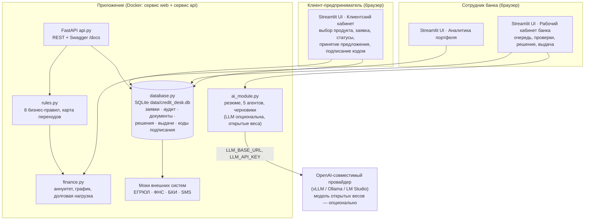

# Архитектура решения

## Назначение

«Кредитный кабинет предпринимателя» — демонстрационный MVP сквозного кредитного
конвейера для действующих клиентов-предпринимателей (ИП и юрлица): от
потребности в финансировании до смоделированной выдачи кредита. Обе стороны
процесса реализованы в одном приложении: клиентский кабинет и обработка заявки
со стороны банка. Все данные синтетические, внешние системы смоделированы.

## Компоненты

* **`app.py`** — интерфейс (Streamlit): клиентский кабинет, рабочий кабинет
  банка, аналитика портфеля, описание проекта. Демо-вход по PIN.
* **`api.py`** — тот же жизненный цикл поверх REST (FastAPI): автоматическая
  Swagger-документация на `/docs`, спецификация `/openapi.json`, Postman-коллекция
  в `postman_collection.json`.
* **`database.py`** — SQLite-хранилище (WAL): заявки, аудит, документы,
  решения, выдачи, коды подписания. Валидация переходов по карте статусов.
  Данные не теряются между этапами и перезапусками (том `./data`).
* **`rules.py`** — 8 прозрачных бизнес-правил (R-01…R-08), справочники
  статусов, карта разрешённых переходов `ALLOWED_TRANSITIONS`.
* **`finance.py`** — аннуитет, график платежей, долговая нагрузка, лимиты;
  демо-ставки привязаны к ключевой ставке ЦБ (14%).
* **`ai_module.py`** — ИИ-слой: детерминированный режим (по умолчанию) и
  режим API с любым OpenAI-совместимым провайдером открытых весов
  (`LLM_BASE_URL` / `LLM_API_KEY` / `LLM_MODEL`). ИИ не принимает решение.
* **`Dockerfile` + `docker-compose.yml`** — два сервиса из одного образа:
  `web` (Streamlit :8501) и `api` (uvicorn :8000) с общим томом `./data`.

## Разделение ответственности: система и человек

Операция | Исполнитель | Обоснование
--- | --- | ---
Проверка полноты и формата заявки, расчёт показателей, сверка с порогами | Система (`rules.py`) | Детерминированные проверки, человек не должен считать вручную
Сведение сигналов, резюме, черновик запроса клиенту | ИИ-агенты (опционально) | Экономия времени аналитика; результат — материал, не решение
Переходы `SUBMITTED→VALIDATION→ENRICHMENT→SCORING` | Система по кнопке сотрудника | Формальные этапы конвейера
Кредитное решение (одобрить / отказать / встречное / запросить уточнения) | Сотрудник банка (старший аналитик) | Ответственность и обоснование — за человеком; система только подсвечивает сигналы
Принятие предложения, подписание, получение кредита | Клиент | Сделка — волеизъявление клиента

## Смоделированные внешние системы

Реальных интеграций с системами Альфа-Банка нет. Место каждой внешней системы
обозначено в архитектуре и заменено минимальным интерфейсом/заготовкой:

| Система | Смоделировано | Где |
| --- | --- | --- |
| ЕГРЮЛ/ЕГРИП | фиксированный mock-ответ «действующая» | `app.py`, карточка «Источники» |
| ФНС | mock-ответ «задолженностей нет» | `app.py` |
| БКИ | mock «score 750» либо флаг неполноты `missing_bki` (меняет маршрут заявки) | `rules.py` R-05 |
| SMS/пуш-доставка кода | код показывается в интерфейсе и ответе API | `database.create_signing_code` |
| ЭП/Госключ/ДБО | подписание демо-кодом внутри продукта | `database.sign_application` |
| Процессинг/проводки | выдача — запись о зачислении на демо-счёт | `database.disburse` |

## Допущения и границы

* Аутентификация — демо-PIN (регистрация не нужна: рассматривается действующий
  клиент); в production — вход в ДБО/SSO, серверное разграничение доступа.
* Обработка документов (OCR, выписки) не входит в MVP — по кейсу это
  дополнительная функциональность; место будущего ML-модуля — `rules.py`/`ai_module.py`.
* Посткредитное обслуживание не входит в основной сценарий (заканчивается выдачей).
* Правила, ставки и лимиты — демонстрационные; ставки привязаны к ключевой
  ставке ЦБ РФ 14% (справочно в `finance.KEY_RATE_PCT`).
