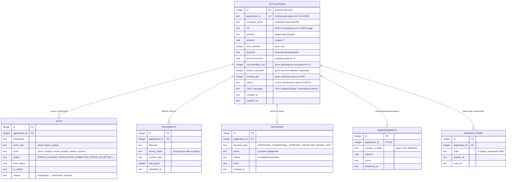

# Модель данных

Хранилище — SQLite (режим WAL), файл `data/credit_desk.db`. Схема создаётся
автоматически (`database.SCHEMA`), при первом запуске наполняется
синтетическими демо-данными. Состав полей выбран так, чтобы каждый параметр
имел смысл для кредитного процесса (по кейсу обязательного списка полей нет).

## ER-диаграмма

## Пояснения к сущностям

* **applications** — заявка и все введённые клиентом данные. Сохраняются между
  этапами и перезапусками: статус, решение, документы и аудит никогда не
  перезаписываются, только дополняются. Статус ограничен `CHECK`-ограничением.
* **audit** — полный журнал: кто, когда и на каком основании менял статус.
  Пишется при каждом переходе (`database.update_status`) и при клиентских
  событиях (подача, уточнение, принятие предложения, подписание).
* **decisions** — кредитные решения с текстовым обоснованием (минимум 15
  символов проверяется интерфейсом и API). История решений хранится целиком.
* **disbursements** — смоделированная выдача (одна на заявку, `UNIQUE`):
  демо-счёт, сумма, условия. Реальные проводки не выполняются.
* **signing_codes** — демо-коды подписания (имитация SMS/ЭП), TTL 15 минут,
  одноразовые.
* Файлы документов хранятся на диске в `data/uploads/` (том Docker),
  метаданные — в `documents`. Размер ограничен 12 МБ, имена очищаются
  (`_safe_name`).

## Синтетические демо-данные

Пять заявок (`_seed_demo`) покрывают все ветки сценария:

| # | Компания | Продукт | Статус | Что демонстрирует |
| --- | --- | --- | --- | --- |
| 1 | ООО «Северный склад» | Оборотное финансирование | MANUAL_REVIEW | Блокирующие сигналы: концентрация 62%, несопоставимые периоды |
| 2 | ООО «Тёплый хлеб» | Краткосрочное финансирование | NEEDS_INFO | Запрос уточнений (неполные данные БКИ) |
| 3 | ИП Соколов А. В. | Кредит на развитие бизнеса | SUBMITTED | Чистая новая заявка — полный конвейер до выдачи |
| 4 | ООО «ТехноПарк-Юг» | Оборотное финансирование | CONDITIONAL_APPROVAL | Встречное предложение (сумма −10%) — принятие клиентом |
| 5 | ООО «Марена-Логистик» | Кредит на развитие бизнеса | DISBURSED | Завершённая сделка: одобрение → принятие → подписание → выдача |

Сброс демо-данных — кнопка в сайдбаре или POST `/api/demo/reset`.

## Тестовые учётные записи

| Роль | PIN (демо) | Заголовок API | Доступно |
| --- | --- | --- | --- |
| Клиент (ИП Соколов А. В.) | `1234` | `X-Demo-Pin: 1234` | Заявки, принятие предложения, подписание, получение кредита |
| Аналитик банка | `0007` | `X-Demo-Pin: 0007` | Очередь, проверки, запрос уточнений |
| Старший аналитик / админ | `0007` | `X-Demo-Pin: 0007` | Плюс финальное решение и выдача |
