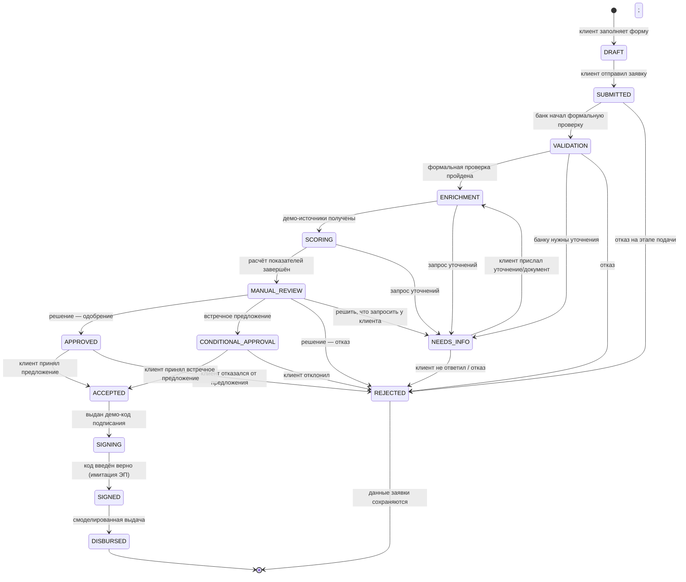

# Диаграмма состояний заявки

Единый справочник статусов и карта переходов реализованы в `rules.py`
(`STATUS_LABELS`, `ALLOWED_TRANSITIONS`) и применяются и интерфейсом, и API:
недопустимый переход отклоняется с пояснением.

## Описание переходов

| Переход | Кто инициирует | Условие / обоснование |
| --- | --- | --- |
| `DRAFT → SUBMITTED` | Клиент | Валидация полей пройдена (название, ИНН 10/12 цифр, продукт, срок из линейки, сумма); дубль по ИНН среди активных заявок запрещён |
| `SUBMITTED → VALIDATION` | Банк | Формальная проверка реквизитов |
| `VALIDATION → ENRICHMENT` | Банк | Запрос смоделированных источников (ЕГРЮЛ, ФНС, БКИ) |
| `* → NEEDS_INFO` | Банк | Неполные данные БКИ, несопоставимые периоды, концентрация выручки — формируется текст запроса клиенту |
| `NEEDS_INFO → ENRICHMENT` | Клиент | Клиент приложил документ/пояснение — заявка возвращается на обработку, данные не теряются |
| `SCORING → MANUAL_REVIEW` | Банк | Показатели рассчитаны; решение — за сотрудником |
| `MANUAL_REVIEW → APPROVED` | Банк (старший аналитик) | Обязательное текстовое основание решения; условия фиксируются в карточке решения |
| `MANUAL_REVIEW → CONDITIONAL_APPROVAL` | Банк (старший аналитик) | Встречное предложение (например, сумма снижена на 10% из-за сезонности) |
| `MANUAL_REVIEW → REJECTED` | Банк (старший аналитик) | Обязательное основание отказа |
| `APPROVED/CONDITIONAL_APPROVAL → ACCEPTED` | Клиент | Принятие предложения в личном кабинете |
| `APPROVED/CONDITIONAL_APPROVAL → REJECTED` | Клиент | Отказ от предложения — заявка закрывается; для новой заявки клиент подаёт новую (новая запись) |
| `ACCEPTED → SIGNING` | Клиент | Выдача демо-кода подписания (имитация SMS, TTL 15 минут) |
| `SIGNING → SIGNED` | Клиент | Верный код; в аудит пишется, что реальная ЭП не использовалась |
| `SIGNED → DISBURSED` | Система | Смоделированная выдача: номер демо-счёта, сумма, дата; реальные проводки не выполняются |

Терминальные статусы — `REJECTED` и `DISBURSED`. История всех переходов
(актёр, роль, основание, timestamp) пишется в таблицу `audit` и видна
клиенту и банку.

## Повторная подача после отказа

Данные отклонённой заявки сохраняются (аудит и документы остаются в базе).
Повторная подача — новая заявка с новым номером: она может быть подана на тот
же или другой продукт; ограничение действует только на **активные** дубли по
ИНН (`inn_has_active_application`), поэтому после отказа/выдачи клиент может
подать новую заявку сразу.
